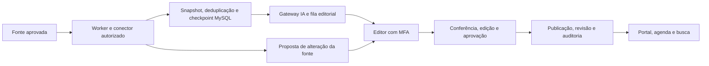

# Arquitetura integrada — Sprints 03 e 03B

`MinhaBelem.Web → MinhaBelem.Infrastructure → MinhaBelem.Core`. A Web usa os contratos Core; Infrastructure fornece MySQL/Dapper, Identity stores, conectores, IA, Places e workers. `AddMinhaBelemInfrastructure` é o ponto único de composição. Serviços Web legados foram removidos; tabelas antigas permanecem para importação explícita e preservação de dados.

## Persistência e concorrência

Um `MySqlDataSource` com pool limitado atende a aplicação. Sessões MySQL usam UTC; a interface converte para America/Belém. Importação de candidato, revisão e auditoria usam transações. Edições verificam o número de revisão para impedir sobrescrita concorrente. Mudanças da fonte criam propostas comparáveis, sem sobrescrever publicações. Recorrências têm identificador por ocorrência.

O SQL canônico é embarcado sem cópia divergente. O migrador explícito usa lock MySQL e checksum por seção. DDL MySQL tem commit implícito: não se promete rollback transacional do esquema inteiro.

## Coleta e integrações

Há uma instância registrada do coletor e um lock distribuído MySQL por ciclo. Fontes usam escopos independentes, paralelismo limitado, agendamento persistido, cotas, checkpoint, ETag/Last-Modified, retries transitórios limitados e backoff de até 24 horas. O ciclo padrão é dez minutos; frequência e cota da fonte prevalecem. Reiniciar o processo retoma candidatos pendentes. O coletor nunca publica.

RSS/Atom, iCalendar, JSON-LD, JSON personalizado/governamental, pesquisa autorizada e APIs sociais usam o mesmo registro de conectores. `Html` lê Event JSON-LD, sem scraping genérico; `Json` é compatibilidade com JSON personalizado. APIs sociais aguardam credenciais e escopos reais.

Groq, Gemini e DeepSeek usam o gateway existente com fallback limitado e rastreio de modelo, tokens, custo estimado e falhas. A IA sugere dados; não recebe autoridade de publicação. Texto externo é entrada não confiável. A triagem local retém determinados padrões de dados sensíveis/menores antes do envio externo.

O guia persiste IDs Places e informações editoriais próprias. Dados Google/fotos são consultados na requisição, com `no-store` e créditos. OCR/vídeo exigem autorização da fonte, licença/crédito por mídia, hosts permitidos e executáveis locais. Bytes de mídia ficam em memória; extração, direitos e ator ficam persistidos.

## Acesso e segurança

Identity guarda hashes de senha e protege tokens TOTP/recuperação com Data Protection. Permissões exigem prova de MFA na sessão. Suspensão, troca de senha/perfil e revogação invalidam acesso. Permissões customizadas ficam separadas dos seeds e sobrevivem à reexecução SQL.

Saída HTTP usa HTTPS, validação IP/DNS, conexão ao IP público validado e bloqueio de redirects/redes privadas ou reservadas. Credenciais são referências a segredos vinculados ao domínio autorizado. Razor faz escaping, formulários usam antiforgery e SQL usa parâmetros. Rate limiting local por processo precisa de complemento no proxy em múltiplas instâncias.

Consulte [evidências e limites](SPRINT-03-HOMOLOGACAO.md). A arquitetura não substitui homologação externa, revisão de privacidade ou validação do servidor de produção.
