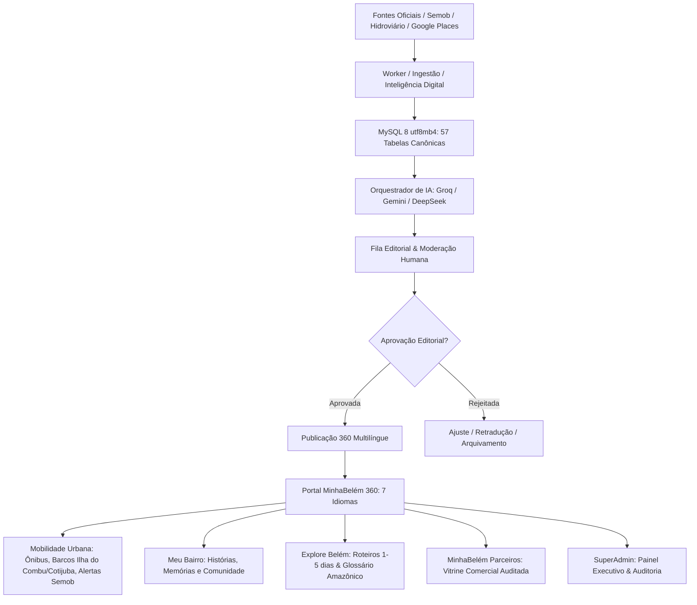

# Arquitetura integrada — Sprints 03, 03B, 04 e 05 (MinhaBelém 360)

`MinhaBelem.Web → MinhaBelem.Infrastructure → MinhaBelem.Core`. A Web usa os contratos Core; Infrastructure fornece MySQL/Dapper, Identity stores, conectores, IA, Places, Internacionalização, Mobilidade, Guias Comunitários e workers. `AddMinhaBelemInfrastructure` é o ponto único de composição. Serviços Web legados foram removidos; tabelas antigas permanecem para importação explícita e preservação de dados.

## Persistência e Concorrência

Um `MySqlDataSource` com pool limitado atende a aplicação. Sessões MySQL usam UTC; a interface converte para America/Belém. Importação de candidato, revisão e auditoria usam transações. Edições verificam o número de revisão para impedir sobrescrita concorrente. Mudanças da fonte criam propostas comparáveis, sem sobrescrever publicações. Recorrências têm identificador por ocorrência.

O SQL canônico é embarcado sem cópia divergente em `MINHABELEM.SQL`. O migrador explícito usa lock MySQL e checksum SHA256 por seção (`MINHABELEM`, `003_operacao`, `004_descoberta`, `005_localidades`, `006_midia`, `007_relacionamentos`, `008_internacionalizacao_turismo`, `009_mobilidade_comunidade_parceiros`).

## Mobilidade Urbana (Sprint 05)

* Cadastro e consulta de linhas de ônibus municipais e intermunicipais (`mb_transit_lines`), incluindo BRT e linhas troncais de Belém com tarifa, acessibilidade de cadeirantes e itinerário.
* Travessias fluviais e transporte hidroviário ribeirinho (`mb_river_routes`) para as ilhas de Belém (Ilha do Combu, Cotijuba, Mosqueiro) com pontos de embarque (Ver-o-Peso, Praça Princesa Isabel, Icoaraci).
* Boletim e alertas operacionais da Semob (`mb_transit_alerts`) com nível de severidade e rotas de desvio.

## Comunidade & Meu Bairro (Sprint 05)

* Guias históricos e culturais dos bairros de Belém (`mb_neighborhood_guides`), destacando tradições locais, pontos turísticos, gastronomia e eventos comunitários.
* Participação cidadã com envio de mensagens e sugestões de eventos, protegidos por sanitização HTML contra ataques XSS e conformidade com a LGPD.

## Monetização & MinhaBelém Parceiros (Sprint 05)

* Vitrine de anunciantes com planos Comercial, Gastronomia e Cultural.
* Identificação explícita de conteúdo publicitário ("Publicidade Verificada").
* Métricas reais de visualizações e cliques persistidas em `mb_campaign_metrics` para prestação de contas aos anunciantes.

## Internacionalização e Localização (Sprint 04 & 05)

1. **7 Idiomas Nativos Suportados:** `pt-BR` (Português - Padrão Editorial), `en` (Inglês), `fr` (Francês), `es` (Espanhol), `ru` (Russo com suporte cirílico completo), `zh-Hans` (Chinês Simplificado com fontes CJK) e `ja` (Japonês com Kanji/Kana).
2. **Resolução de Cultura:**
   * Rotas localizadas opcionais: `/{culture}/...` (ex: `/en/guia`, `/fr/agenda`, `/ja/explore`).
   * Cookie seguro persistente: `mb_culture` gerado no endpoint `/idioma/mudar`.
   * Cabeçalho de negociação HTTP: `Accept-Language`.
3. **Catálogo Unificado e Resx:** Paridade estrita de 100% de chaves em todos os idiomas, validada continuamente por `LocalizationCatalog.VerifyCompleteness()`.
4. **SEO Multilíngue:** Canonical URLs, tags de cabeçalho `xhtml:link` com atributos `hreflang` para os 7 idiomas mais `x-default`, e `/sitemap.xml` estruturado.
5. **Busca Multilíngue:** Consultas Dapper com busca inteligente em tabelas de tradução (`mb_content_translations` e `mb_place_translations`) sem quebrar a indexação original.

## Inteligência de Tradução e Preservação Cultural

* Gateway único com fallback automático entre **Groq**, **Google Gemini** e **DeepSeek**.
* **Preservação de Expressões Culturais:** Nomes autóctones e expressões paraenses sagradas (*Ver-o-Peso, Círio de Nazaré, Tacacá, Maniçoba, Carimbó, Açaí, Tucupi, Jambu*) são protegidos contra traduções literais impróprias e enriquecidos com notas de contexto cultural para o leitor estrangeiro.
* O texto original em português nunca é sobrescrito. Cada tradução gera um registro imutável com versionamento, provedor, modelo e status de moderação (`Pending`, `Approved`, `Rejected`).

## Portal Turístico "Explore Belém"

* Módulo dedicado em `/explore` com roteiros completos de 1, 2, 3 e 5 dias.
* Cada roteiro inclui paradas sequenciais (`mb_tourist_itinerary_stops`), período do dia, duração estimada, dicas de experiência e integração com Google Maps.
* Orientações práticas verificadas sobre o clima equatorial (chuvas da tarde), segurança (DEATur, Polícia 190, SAMU 192) e acessibilidade motora.

Consulte [evidências e homologação Sprint 05](SPRINT-05-HOMOLOGACAO.md). A arquitetura não substitui homologação externa, revisão jurídica ou validação do servidor de produção.
